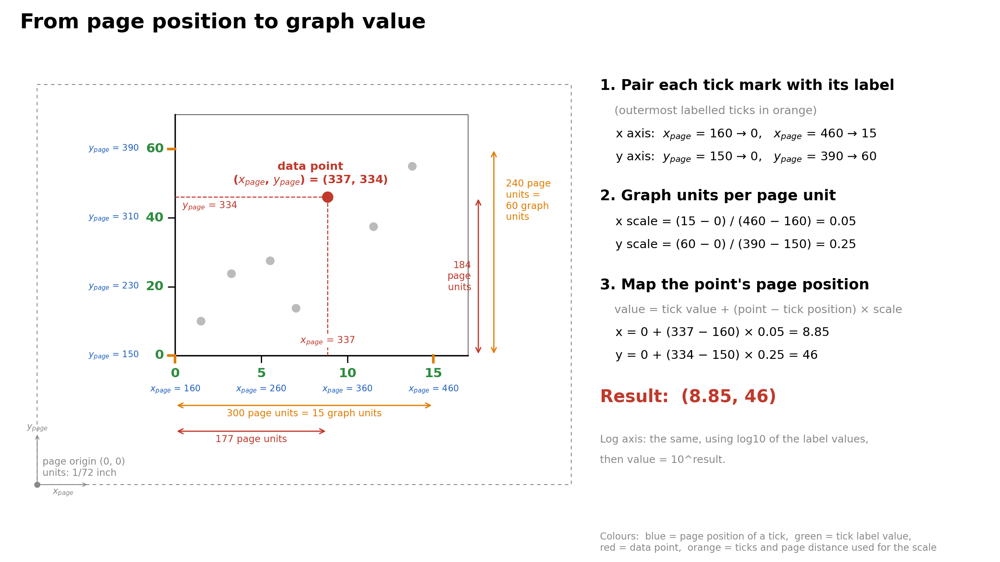

# pdfgraph2csv

Extract the x/y coordinates of data points, displayed as symbols within a graph drawn using vector graphics, within a pdf file.  Graphs represented using raster graphics (e.g., jpeg and png formats) are ignored.

The following command sends the x/y coordinates of any detected data points within any graphs contained in ``interesting.pdf`` to standard output:

``python3 pdfgraph2csv.py interesting.pdf``

specifying an output file:

    python3 pdfgraph2csv.py interesting.pdf -o interesting.csv

By default the message ``warning: No vector graphics found`` is output when no data points are detected.

`python3 pdfgraph2csv.py --help` lists the options.

    usage: pdfgraph2csv.py [--debug] [--digits N] [--errbars] [--exclude-legend] [--glyph-centre {marker,bbox}] [-h]
                       [--heatmap] [--inside-only] [--integer AXIS] [--internal] [--max-symbol-frac MAX_SYMBOL_FRAC] [--max-words N]
                       [-meta FILE] [--meta-only] [-o OUTPUT] [--pages PAGES] [--password PASSWORD] [--progress]
                       [--rotation] [--sizesymbol]
                       pdf

    positional arguments:
       pdf                  input PDF file

    options:
      --debug               print axis detection details
      --digits N            significant digits output (default: based on the accuracy of the program that drew the graph, if known, else the precision of the PDF's coordinates, at least 6)
      --errbars             output the ends of each point's error bars
      --exclude-legend      do not report the marker symbols of legend keys
      --glyph-centre {marker,bbox} data point of a ZapfDingbats marker glyph: the plotting convention (0.396, 0.347) em (default) or the centre of the glyph's bounding box
      --heatmap             attempt to match symbol colors against a legend colour/grey scale
      -h, --help            show this help message and exit
      --inside-only         only report symbols inside the axis rectangle
      --integer AXIS        round axis values (x or y; may be given twice) to whole numbers
      --internal            output the symbol centres in PDF page coordinates
      --max-symbol-frac MAX_SYMBOL_FRAC maximum symbol size as a fraction of the plot area's smaller side (default 0.1)
      --max-words N         maximum words of running text (i.e., lines of three or more words; words of three letters or more; default 20)
      -meta FILE, --meta FILE  write graph meta data
      --meta-only           only write the -meta file (no csv of data point values is generated)
      -o OUTPUT, --output OUTPUT  write to file OUTPUT (default: stdout)
      --pages PAGES         comma separated page numbers, e.g. 1,3
      --password PASSWORD   password of an encrypted PDF (user or owner password)
      --progress            output page number as it is processed and seconds since processing started
      --rotation            output the rotation of each point's graph (0, 90, -90 or 180 degrees)
      --sizesymbol          output the size of each point's marker in PDF points (1/72 inch) - the diameter of a circle, the average edge length of a box (other shapes: the mean of their bounding box's width and height)

By default x/y values are written with as many significant digits as used by the program that drew the graph (as recorded in the PDF), when the accuracy of the coordinates it writes is known (e.g., R's pdf() device: 0.01 pt; matplotlib: 10^-6 pt).  Otherwise the default of 6 digits is used. The option `--digits N` overrides any internal significant digit selection process.

The program needs python 3.9+

    pip install -r requirements.txt     # pikepdf, pdfminer.six, fonttools, python-dateutil

meta-data about each graph found can output:

    python3 pdfgraph2csv.py interesting.pdf -o interesting.csv -meta interesting-meta.csv

or the meta file alone, without the data point values:

    python3 pdfgraph2csv.py interesting.pdf -meta interesting-meta.csv --meta-only

with the columns page, graph, title, figure (number), caption, tool (the program that drew the graph, when the PDF records it: e.g. `R 4.0.2`, `Matplotlib v3.7.2`, `MATLAB ... (R2017b)`, `Adobe Illustrator CS5`; taken from the information an embedded graphic keeps about its own file, or from the document information when the PDF is itself a plot; programs that only convert to PDF, such as Ghostscript, Acrobat Distiller or a printer driver, are not reported), tool_guess (a best guess from the drawing style, independent of the recorded tool: `R`, `R (ggplot2)`, `R (lattice)`, `matplotlib`, `MATLAB`, `Excel`, `gnuplot`, `Mathematica` or `Stata`, from default colours, fonts, line caps and joins, the decimals of the coordinates and the names given to marker drawings and graphics states; empty when no program stands out; see `pdfpoints/styles.py`), points (the number of data points output for the graph), x_tick_min, x_tick_max, y_tick_min, y_tick_max (the values of the lowest and highest labelled ticks of each axis; for a category axis, the first and last category); and, when some graph has a scale on both sides, axis2, axis2_tick_min, axis2_tick_max (which second scale, e.g. `y right`, and its lowest and highest labelled ticks).  Title, figure and caption are empty when none is found; a caption is the paragraph starting "Fig. N" or "Figure N" below the graph, shared by all the graphs of that figure.  The file is only created when graphs are found.

A myriad of different ways are used to display symbols denoting data values, e.g., instruction to output a circle, or four instructions that output the four (sometimes eight) bezier curves forming the quadrants of a circle.

| Package | Used for |
|---|---|
| pikepdf (qpdf) | opening the file: repairing damaged files, decryption (RC4, AES-128/256), decoding streams |
| pdfminer.six | the content-stream interpreter, resources, fonts and CMaps, standard-14 font metrics |
| fontTools | glyph names → Unicode (Adobe Glyph List) for fonts with /Differences |
| python-dateutil | month names and date tick labels ("Mar 2010", "2010-03-15", "Jan-10") |

To find out which graphs are in raster format use the [pdfcpu tool](https://github.com/pdfcpu/pdfcpu).  The following command will extract most rasther images contained in `interesting.pdf`, and write them in their image format to the directory `im_dir`:

    pdfcpu extract -m image interesting.pdf im_dir

If a graph is not extracted as an image, and you suspect it has a vector form that is not being detected, then the checking process is somewhat involved.  First extract the page containing the graph, then [uncompressing the pdf, and looking at the sequences of internal pdf instructions](https://shape-of-code.com/2025/07/27/a-process-to-find-and-extract-data-points-from-graphs-in-pdf-files/).

## Regression tests

See [tests/README.md](tests/README.md): how to run the suite, what each test.
